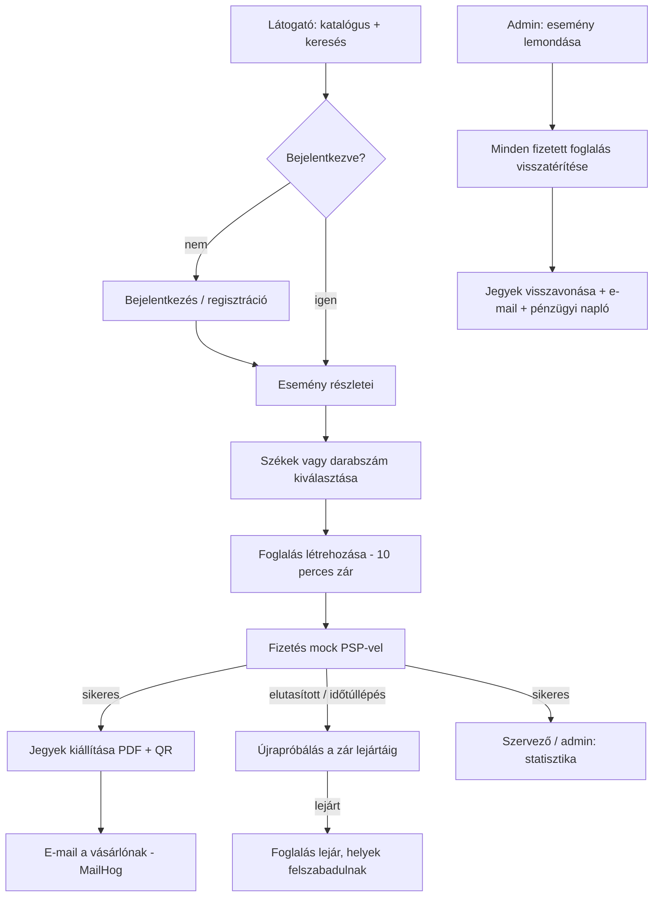

# 01 — Látásmód és hatókör

> Ez a dokumentum a **Jegyzo** termék célját, szereplőit és a v1 hatókörét rögzíti.
> Minden további dokumentum és minden User Story ebből vezethető le.

---

## 1. A termék

A **Jegyzo** egy magyar nyelvű, webes **jegyértékesítő platform**: a látogatók
koncertekre és egyéb rendezvényekre vásárolhatnak jegyet, a szervezők és
adminisztrátorok pedig eseményeket, helyszíneket, árazást és felhasználókat
kezelnek egy belső (backoffice) felületen.

A rendszer **nem** valós fizetési szolgáltatással dolgozik: a bankkártyás fizetés
egy **szimulált (mock) fizetési szolgáltatón** keresztül történik, amely
determinisztikusan állítja elő a sikeres, elutasított vagy időtúllépéses
eredményeket. Minden kimenő e-mail egy helyi MailHog szerverre kerül.

A termék elsődleges célja, hogy **tesztelhető legyen**:

- valósághű, háromrétegű elosztott rendszer (adatbázis + API + webes felület),
- olyan üzleti szabályok, amelyek határérték-, ekvivalenciaosztály-,
  állapotátmenet- és versenyhelyzet-tesztelést egyaránt megengednek,
- kiszámítható, dokumentált demo adatkészlet, amelyre konkrét állítások
  fogalmazhatók meg.

## 2. Szereplők

| Szerepkör | Magyar elnevezés | Kódnév | Leírás |
| --- | --- | --- | --- |
| Vásárló | vásárló | `VASARLO` | Regisztrált látogató. Böngészi a katalógust, jegyet vásárol, megtekinti és letölti a jegyeit, kezeli a profilját. |
| Szervező | szervező | `SZERVEZO` | A saját maga által létrehozott eseményeket és azok jegytípusait kezeli. Más szervező eseményéhez nem fér hozzá. |
| Adminisztrátor | adminisztrátor | `ADMIN` | Teljes jogosultság: minden esemény, helyszín, felhasználó, foglalás és visszatérítés kezelése. |

Nem célzott szereplő: névtelen (bejelentkezés nélküli) felhasználó **kizárólag**
a nyilvános eseménykatalógust és az esemény részleteit láthatja. Vásárláshoz
bejelentkezés szükséges.

### Szerepkör-mátrix

| Művelet | Névtelen | Vásárló | Szervező | Admin |
| --- | :-: | :-: | :-: | :-: |
| Eseménylista / keresés / részletek | ✅ | ✅ | ✅ | ✅ |
| Jegyvásárlás | ❌ | ✅ | ✅ | ✅ |
| Saját foglalások és jegyek | ❌ | ✅ | ✅ | ✅ |
| Saját profil módosítása | ❌ | ✅ | ✅ | ✅ |
| Esemény létrehozása / szerkesztése | ❌ | ❌ | ✅ (saját) | ✅ (bármely) |
| Esemény publikálása / szüneteltetése | ❌ | ❌ | ✅ (saját) | ✅ (bármely) |
| Esemény lemondása | ❌ | ❌ | ❌ | ✅ |
| Helyszín kezelése | ❌ | ❌ | ❌ | ✅ |
| Felhasználók kezelése | ❌ | ❌ | ❌ | ✅ |
| Bármely foglalás megtekintése | ❌ | ❌ | ✅ (saját esemény) | ✅ |
| Visszatérítések listája | ❌ | ❌ | ❌ | ✅ |

## 3. Elsődleges felhasználói utak

### 3.1 Vásárlás (happy path)

1. A látogató megnyitja az eseménykatalógust, szűr és keres.
2. Kiválaszt egy eseményt, megnyitja a részleteit.
3. Kiválaszt egy szektort és konkrét székeket (ülőhelyes esemény), vagy megadja
   a darabszámot (állóhelyes esemény).
4. A rendszer **foglalást** hoz létre: a kiválasztott helyek **10 percre
   lezárásra** kerülnek.
5. A vásárló megadja a kártyaadatait, a fizetés a mock szolgáltatón keresztül lefut.
6. Sikeres fizetés esetén a jegyek kiállítódnak (PDF + QR), a helyek „eladott”
   állapotba kerülnek, és e-mail megy a vásárlónak.
7. A vásárló a „Jegyeim” oldalon látja és letöltheti a jegyeit.

### 3.2 Esemény létrehozása (szervező / admin)

1. Új esemény felvétele: név, kategória, helyszín, kezdés, leírás, plakát.
2. Jegytípusok felvétele (szektoronként egy), ár és értékesítési ablak megadása.
3. **Publikálás** – csak akkor lehetséges, ha minden kötelező adat megvan és van
   legalább egy aktív jegytípus (lásd `BR-19`).
4. Publikálás után az esemény megjelenik a nyilvános katalógusban.

### 3.3 Esemény lemondása (admin)

1. Az admin a backoffice-ban lemondja az eseményt.
2. A rendszer minden fizetett foglalást visszatérít (teljes összeg), a jegyeket
   visszavonja, a függő foglalásokat lezárja, a helyeket felszabadítja.
3. Minden érintett vásárló e-mailt kap.
4. A visszatérítések megjelennek a visszatérítési listában és a pénzügyi naplóban.

## 4. Hatókör

### 4.1 v1-ben benne van

| Terület | Tartalom |
| --- | --- |
| Eseménykatalógus | lista, keresés, szűrés (kategória, város, helyszín, dátumtartomány, ártartomány, szabad hely), rendezés, lapozás, esemény részletei |
| Helyszín- és ülőhelykezelés | helyszín CRUD, szektor / sor / szék struktúra, állóhely-blokkok, ülőhelytérkép megjelenítés és szabad/foglalt állapot |
| Jegyek és árazás | ülőhelyes és állóhelyes (kapacitás alapú) jegytípus, ár HUF-ban, vásárlói limit, értékesítési ablak |
| Foglalás | helyek zárolása, lejárat, kapacitáskezelés, egyidejűség kezelése |
| Fizetés | mock bankkártyás fizetés, determinisztikus kimenetelek, idempotencia, tranzakciós napló |
| Jegykibocsátás | PDF jegy QR-kóddal, letöltés, nyilvános érvényesség-ellenőrzés |
| Értesítések | e-mail MailHog-on keresztül (jegykibocsátás, visszatérítés, esemény lemondása) |
| Felhasználói fiók | regisztráció, bejelentkezés (JWT), profil, jelszócsere, foglalási előzmények |
| Admin backoffice | esemény, helyszín, jegytípus, felhasználó, foglalás kezelés, egyszerű statisztika, visszatérítési lista |
| Lemondás és visszatérítés | esemény lemondása, automatikus visszatérítés, pénzügyi napló |
| Nyelv | magyar alapértelmezett felület, angolra váltható, `Accept-Language` az API-n |

### 4.2 v1-ben nincs benne

- Kuponok, kedvezménykódok, akciók.
- Értékelések, hozzászólások, közösségi funkciók.
- Wallet, loyalty pontok, jegy-viszonteladás.
- **Vásárló által kezdeményezett** visszatérítés (visszatérítés kizárólag
  esemény lemondása miatt történik).
- Valós fizetési integráció, valós e-mail küldés.
- Jegyellenőrző (beléptető) alkalmazás; a QR-ellenőrzés csak nyilvános API-t kap.
- Csoportos/szervezeti számlázás, számla kiállítás.
- Többpénznemes árazás (kizárólag HUF).

## 5. Üzleti folyamat áttekintés

## 6. Amit a sandbox gyakoroltatni akar

A specifikáció szándékosan tartalmaz olyan szabályokat, amelyek tipikus
tesztelési technikákkal fedhetők le:

| Technika | Példa a Jegyzo-ban |
| --- | --- |
| Ekvivalenciaosztályok | érvényes / lejárt / Luhn-hibás kártyaszám; aktív / inaktív jegytípus |
| Határérték-elemzés | 0 / 1 / 8 / 9 jegy egy vásárlásban; zár lejárta 9:59 / 10:00 / 10:01; utolsó szék |
| Állapotátmenetek | foglalás `ZAROLT → FIZETVE`, tilos átmenetek (pl. `LEJART → FIZETVE`) |
| Döntési tábla | esemény állapota × értékesítési ablak × jegytípus állapota → vásárolható-e |
| Versenyhelyzet | két vásárló ugyanarra a székre egyszerre; kapacitás túlfutás állóhelynél |
| Hibakezelés | PSP időtúllépés, elutasítás, majd újrapróbálás |
| Idempotencia | ugyanaz a fizetési kérés kétszer nem terhelhet kétszer |
| i18n | magyar/angol felület és hibaüzenetek |
| Jogosultság | szervező nem módosíthat más szervező eseményét |
| Adatintegritás | lemondott esemény jegyei nem érvényesek, helyek felszabadulnak |

## 7. Feltételezések és korlátok

- A rendszer **egyetlen** API-ból, **egyetlen** webes felületből és **egyetlen**
  PostgreSQL adatbázisból áll; nincs üzenetsor, nincs külön jogosultsági szerver.
- A fizetés **szimulált**; a kártyaadatokat a rendszer nem tárolja, kizárólag a
  kártya utolsó négy számjegyét és a márkát.
- Az e-mail kézbesítés **nem** része a rendszernek: minden levél a MailHog-ba kerül.
- Az időzóna **Európa/Budapest**; a rendszer a dátumokat ebben az időzónában
  értelmezi és jeleníti meg.
- A demo adatkészlet determinisztikus, és a `docker compose` újratöltésével
  mindig ugyanarra az állapotra áll vissza (lásd `NFR-01`, `NFR-12`).
