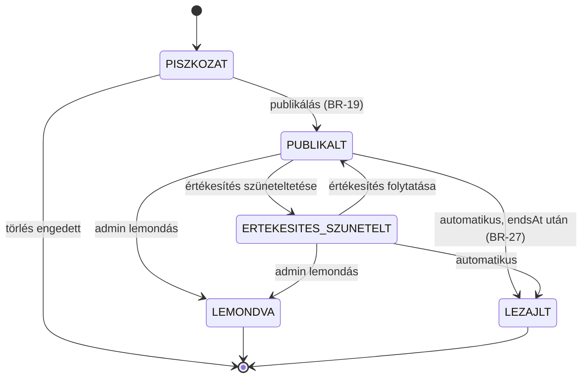
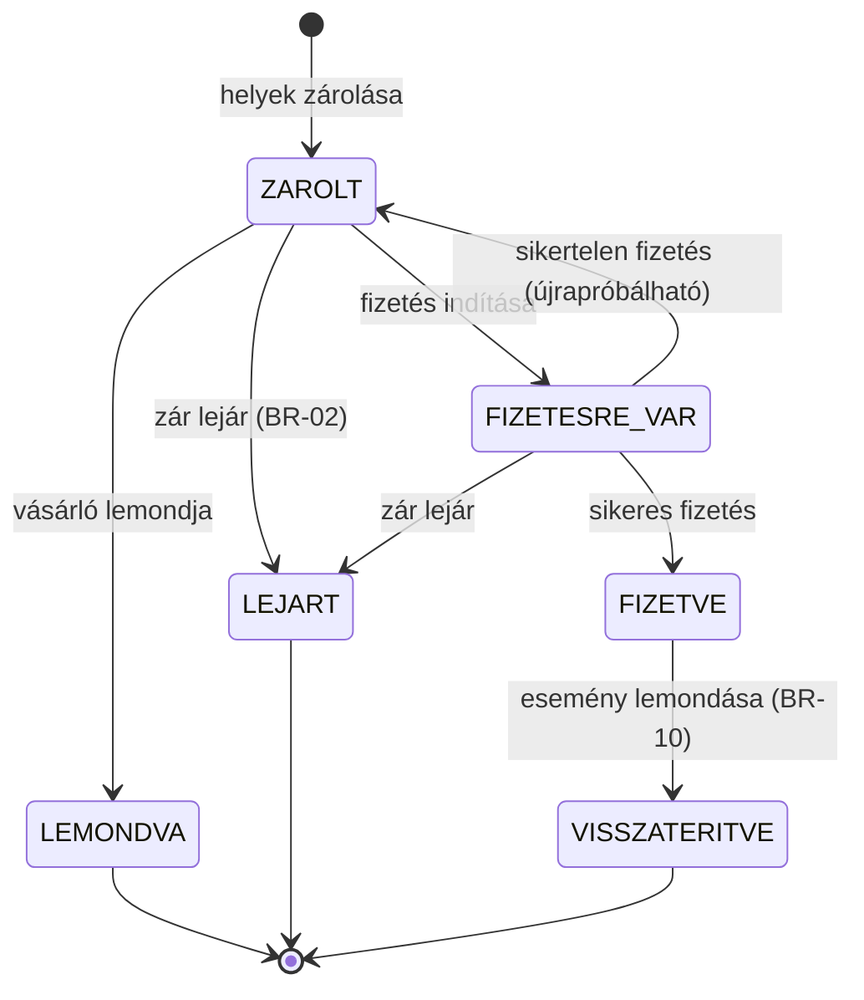
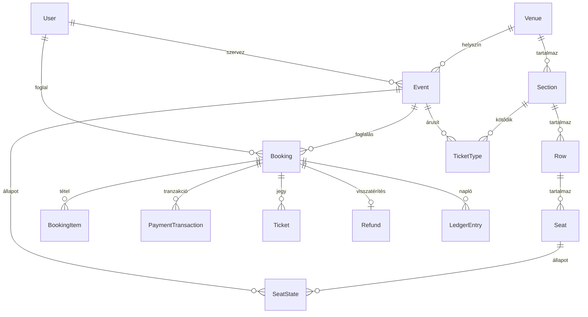

# 02 — Domain szótár és adatmodell

> A dokumentum a **Jegyzo** üzleti fogalmait, entitásait és állapotgépeit
> rögzíti. Az entitásnevek (kódnév) angolul, a magyar megnevezés mellettük
> szerepel – a kódban és az adatbázisban a **kódnevek** használandók.

---

## 1. Szótár

| Magyar fogalom | Kódnév | Jelentés |
| --- | --- | --- |
| Felhasználó | `User` | Regisztrált személy (vásárló, szervező vagy admin). |
| Szerepkör | `UserRole` | `VASARLO` \| `SZERVEZO` \| `ADMIN`. |
| Helyszín | `Venue` | Fizikai helyszín (pl. Papp László Budapest Sportaréna). |
| Szektor | `Section` | A helyszín egysége: ülőhelyes vagy állóhelyes. |
| Sor | `Row` | Ülőhelyes szektoron belüli széksor (pl. „A”, „B”). |
| Szék | `Seat` | Egy konkrét ülőhely (sor + szám). |
| Esemény | `Event` | Koncert vagy egyéb rendezvény egy adott időpontban és helyszínen. |
| Jegytípus | `TicketType` | Egy esemény egy szektorának jegyfajtája, saját árral és szabályokkal. |
| Hely-állapot | `SeatState` | Egy szék állapota **egy adott eseményre** (`SZABAD`, `ZAROLT`, `ELADOTT`). |
| Foglalás | `Booking` | Egy vásárlási kísérlet: kiválasztott helyek/darabszámok pénzügyi összesítéssel. |
| Foglalási tétel | `BookingItem` | Foglalás egy sora: jegytípus + szék (opcionális) + darabszám + ár. |
| Fizetési tranzakció | `PaymentTransaction` | A mock PSP-vel folytatott egyetlen fizetési kísérlet eredménye. |
| Jegy | `Ticket` | Kiállított, egyedi kóddal és QR-tartalommal rendelkező belépő. |
| Visszatérítés | `Refund` | Esemény lemondása miatti pénzvisszatérítés egy foglalásra. |
| Pénzügyi napló | `LedgerEntry` | Bevétel / visszatérítés esemény, jelentéshez és ellenőrzéshez. |
| Értesítés | `EmailNotification` | Kiküldött e-mail (MailHog) nyilvántartása. |
| Szolgáltatási díj | `serviceFee` | Jegyenkénti fix díj (250 Ft) a jegyárakon felül. |
| Zár (hold) | `holdExpiresAt` | A foglalás érvényessége fizetés előtt (10 perc). |

**Fontos megkülönböztetés:** a *hely* fizikai fogalom (hol van), a
*hely-állapot* pedig esemény-specifikus (adott eseményre foglalt-e). Ugyanaz a
szék egyik eseményen eladott, egy másikon szabad.

## 2. Entitások

### 2.1 `User` — Felhasználó

| Mező | Típus | Kötelező | Megszorítás |
| --- | --- | --- | --- |
| `id` | azonosító | ✅ | |
| `email` | szöveg | ✅ | érvényes e-mail formátum, **kis-nagybetűtől függetlenül egyedi** (`BR-16`) |
| `passwordHash` | szöveg | ✅ | bcrypt, sosem kerül ki az API-n (`NFR-06`) |
| `fullName` | szöveg | ✅ | 2–80 karakter |
| `phone` | szöveg | ❌ | `+36` kezdetű, 9 számjegy, szóközök nélkül tárolva |
| `role` | felsorolás | ✅ | `VASARLO` (alapértelmezett) \| `SZERVEZO` \| `ADMIN` |
| `locale` | felsorolás | ✅ | `hu` (alapértelmezett) \| `en` |
| `isActive` | logikai | ✅ | `false` esetén bejelentkezés és vásárlás tiltott (`BR-21`) |
| `createdAt` / `updatedAt` | időpont | ✅ | |

### 2.2 `Venue` — Helyszín

| Mező | Típus | Kötelező | Megszorítás |
| --- | --- | --- | --- |
| `id` | azonosító | ✅ | |
| `name` | szöveg | ✅ | 3–120 karakter |
| `city` | szöveg | ✅ | 2–60 karakter |
| `address` | szöveg | ✅ | 5–200 karakter |
| `description` | szöveg | ❌ | max. 2000 karakter |
| `isActive` | logikai | ✅ | `false` esetén új esemény nem hozható létre rá (`BR-22`) |
| `totalCapacity` | szám | ✅ | számított: ülőhelyek + állóhely-kapacitások összege |

**`Section` (Szektor)** – a helyszínhez tartozik:

| Mező | Típus | Kötelező | Megszorítás |
| --- | --- | --- | --- |
| `venueId` | azonosító | ✅ | |
| `name` | szöveg | ✅ | 2–60 karakter |
| `kind` | felsorolás | ✅ | `ULOHELYES` \| `ALLOHELYES` |
| `capacity` | szám | feltételes | `ALLOHELYES` esetén kötelező, ≥ 1; `ULOHELYES` esetén a székek számából számított |
| `position` | szám | ✅ | megjelenítési sorrend, 0-tól |

**`Row` (Sor)** – csak `ULOHELYES` szektorban: `label` (pl. `A`, `B`, `AA`),
`position`, valamint a hozzá tartozó székek.

**`Seat` (Szék)** – csak `ULOHELYES` szektorban: `number` (1-től folyamatos),
`label` (pl. `A12`).

### 2.3 `Event` — Esemény

| Mező | Típus | Kötelező | Megszorítás |
| --- | --- | --- | --- |
| `name` | szöveg | ✅ | 3–120 karakter |
| `category` | felsorolás | ✅ | `KONCERT` \| `SZINHAZ` \| `SPORT` \| `FESZTIVAL` \| `EGYEB` |
| `venueId` | azonosító | ✅ | létező, aktív helyszín |
| `organizerUserId` | azonosító | ✅ | `SZERVEZO` vagy `ADMIN` |
| `startsAt` | időpont | ✅ | a jövőben kell lennie publikáláskor (`BR-19`) |
| `durationMinutes` | szám | ✅ | 30–600 |
| `doorsOpenAt` | időpont | ❌ | `startsAt` előtt, legfeljebb 3 órával |
| `description` | szöveg | ✅ | 50–4000 karakter |
| `posterUrl` | szöveg | ❌ | kép URL |
| `status` | felsorolás | ✅ | lásd 3.1 |
| `salesStartAt` / `salesEndAt` | időpont | ✅ | `salesStartAt < salesEndAt ≤ startsAt` (`BR-23`) |
| `publishedAt` | időpont | ❌ | publikáláskor töltődik |

### 2.4 `TicketType` — Jegytípus

| Mező | Típus | Kötelező | Megszorítás |
| --- | --- | --- | --- |
| `eventId` | azonosító | ✅ | |
| `sectionId` | azonosító | ✅ | a helyszín egy szektora; **egy eseményen egy szektornak legfeljebb egy jegytípusa lehet** (`BR-24`) |
| `name` | szöveg | ✅ | 2–40 karakter |
| `price` | egész szám | ✅ | HUF, 0–500 000, **egész szám** (`BR-15`) |
| `capacity` | szám | feltételes | `ALLOHELYES` szektornál kötelező |
| `maxPerUser` | szám | ✅ | 1–20, alapértelmezés 8 (`BR-04`) |
| `salesStartAt` / `salesEndAt` | időpont | ✅ | ha nincs megadva, az esemény ablaka érvényes |
| `isActive` | logikai | ✅ | `false` esetén nem vásárolható (`BR-25`) |

### 2.5 `SeatState` — Hely-állapot

Egy rekord = egy szék **egy eseményre**.

| Mező | Típus | Leírás |
| --- | --- | --- |
| `eventId` + `seatId` | összetett kulcs | |
| `state` | felsorolás | `SZABAD` \| `ZAROLT` \| `ELADOTT` |
| `bookingId` | azonosító | kitöltött, ha `ZAROLT` vagy `ELADOTT` |
| `holdExpiresAt` | időpont | csak `ZAROLT` esetén |

Az esemény publikálásakor minden szék `SZABAD` állapotba kerül. Új szék
hozzáadása a helyszínhez nem érinti a korábban publikált eseményeket
(`BR-26`).

### 2.6 `Booking` — Foglalás

| Mező | Típus | Kötelező | Megszorítás |
| --- | --- | --- | --- |
| `code` | szöveg | ✅ | formátum: `JGY-<év>-<6 számjegy>`, egyedi, pl. `JGY-2026-000123` |
| `userId` | azonosító | ✅ | |
| `eventId` | azonosító | ✅ | |
| `status` | felsorolás | ✅ | lásd 3.2 |
| `subtotal` | egész | ✅ | tételek összege |
| `serviceFee` | egész | ✅ | `250 Ft × jegydarabszám` (`BR-07`) |
| `total` | egész | ✅ | `subtotal + serviceFee` |
| `currency` | szöveg | ✅ | mindig `HUF` |
| `holdExpiresAt` | időpont | ✅ | létrehozáskor `now + 10 perc` (`BR-02`) |
| `createdAt` / `paidAt` / `canceledAt` | időpont | ❌ / feltételes | |

**`BookingItem`:** `ticketTypeId`, `seatId` (csak ülőhelyes), `quantity`
(állóhelynél > 1 is lehet, ülőhelynél mindig 1), `unitPrice`, `lineTotal`.

### 2.7 `PaymentTransaction` — Fizetési tranzakció

| Mező | Típus | Leírás |
| --- | --- | --- |
| `bookingId` | azonosító | |
| `amount` | egész | a foglalás `total` értéke |
| `status` | felsorolás | `SIKERES` \| `ELUTASITOTT` \| `IDOTULLEPES` \| `FELDOLGOZASI_HIBA` |
| `cardLast4` | szöveg | 4 számjegy |
| `cardBrand` | felsorolás | `VISA` \| `MASTERCARD` \| `AMEX` \| `EGYEB` |
| `pspReference` | szöveg | a mock PSP azonosítója (pl. `MOCK-8f3a91`) |
| `errorCode` | szöveg | a hibakatalógus kódja (pl. `PAYMENT_DECLINED`), csak sikertelen esetben |
| `attemptNumber` | szám | 1-től növekvő, foglalásonként |
| `idempotencyKey` | szöveg | a kliens által küldött kulcs (`BR-08`) |
| `createdAt` | időpont | |

### 2.8 `Ticket` — Jegy

| Mező | Típus | Leírás |
| --- | --- | --- |
| `bookingId`, `ticketTypeId` | azonosító | |
| `seatId` | azonosító | csak ülőhelyes jegynél |
| `code` | szöveg | egyedi, 12 karakter, pl. `JG7F4K2M9QX1` |
| `qrPayload` | szöveg | `JGY-TICKET:<code>` |
| `status` | felsorolás | `ERVENYES` \| `VISSZAVONT` |
| `issuedAt` | időpont | |
| `revokedAt` | időpont | |

### 2.9 `Refund` és `LedgerEntry`

**`Refund`:** `bookingId`, `amount` (a foglalás teljes `total` értéke),
`reason` (`ESEMENY_LEMONDVA`), `status` (`FUGGO` \| `SIKERES` \| `SIKERTELEN`),
`initiatedByUserId`, `createdAt`, `completedAt`.

**`LedgerEntry`:** `type` (`BEVETEL` \| `VISSZATERITES`), `bookingId`, `amount`,
`eventId`, `createdAt`, `description`.

### 2.10 `EmailNotification` — Értesítés

`toEmail`, `template` (`JEGY_KIIALLITVA` \| `VISSZATERITES_TELJESITVE` \|
`ESEMENY_LEMONDVA`), `locale`, `status` (`ELKULDVE` \| `HIBA`), `sentAt`,
`errorMessage`.

## 3. Állapotgépek

### 3.1 Esemény

### 3.2 Foglalás

> **Tiltott átmenetek** (ezekre teszteset is készül): `LEJART → FIZETVE`,
> `LEMONDVA → FIZETVE`, `FIZETVE → LEJART`, `VISSZATERITVE → *`.

### 3.3 Fizetési tranzakció és jegy

- Fizetési tranzakció **nem** módosítható, kizárólag létrehozható (append-only
  napló).
- Jegy: `ERVENYES → VISSZAVONT` egyetlen megengedett átmenet (`BR-18`).

## 4. Kapcsolatok

## 5. Számítási szabályok

| Számítás | Képlet |
| --- | --- |
| Szabad székek egy eseményre | `count(SeatState.state = SZABAD)` |
| Állóhely szabad kapacitás | `TicketType.capacity − (eladott + zárolt darabszám)` |
| Foglalás részösszege | `Σ(item.quantity × item.unitPrice)` |
| Szolgáltatási díj | `250 Ft × Σ(item.quantity)` |
| Foglalás végösszege | `subtotal + serviceFee` |
| Esemény kihasználtsága | `eladott jegyek / összes jegy kapacitás × 100%` |
| Esemény bevétele | `Σ(LedgerEntry.type = BEVETEL) − Σ(LedgerEntry.type = VISSZATERITES)` |
