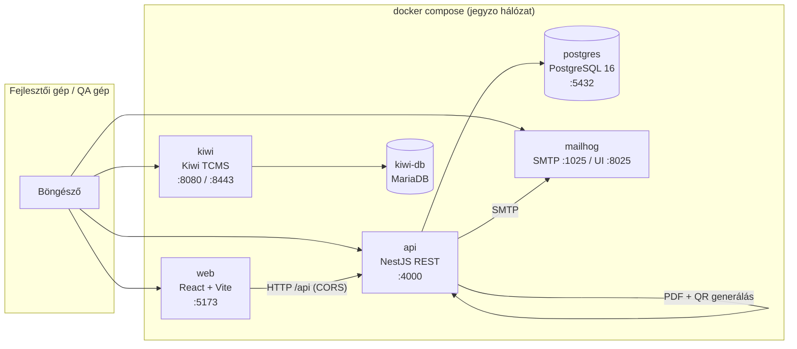
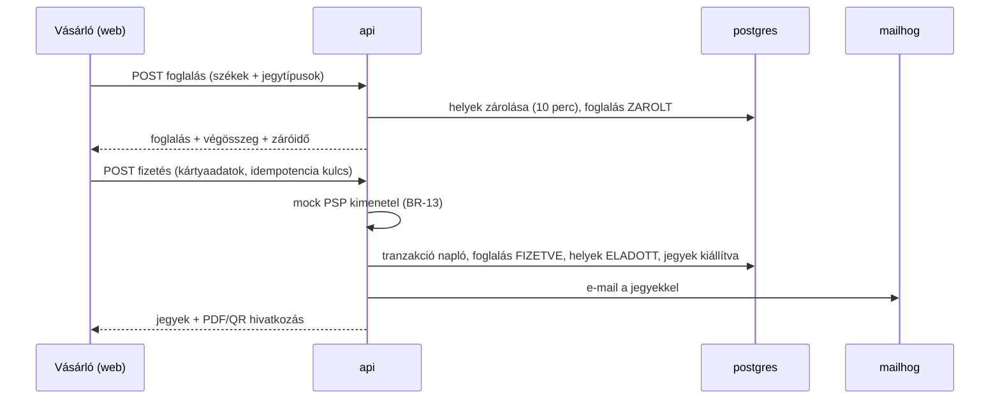

# 01 — Rendszerkép és szolgáltatás-szerződések

> Ez a dokumentum rögzíti, **milyen szolgáltatásokból áll** a Jegyzo, hogyan
> beszélnek egymással, és **mi az a szerződés**, amit az implementáló agentnek
> teljesítenie kell. Ami itt nincs rögzítve (REST útvonalak, adatbázis-séma,
> mappastruktúra, könyvtárválasztás), azt az implementáló **szabadon tervezheti**
> – lásd [../04-ai-agent/01-implementacios-instrukciok.md](../04-ai-agent/01-implementacios-instrukciok.md).

---

## 1. Szolgáltatások

| Szolgáltatás | Technológia | Belső port | Host port (`.env`) | Szerep |
| --- | --- | --- | --- | --- |
| `web` | React + Vite + TypeScript | 5173 | `WEB_PORT` (5173) | Vásárlói és backoffice felület |
| `api` | NestJS + TypeScript (Node 22) | 4000 | `API_PORT` (4000) | REST API, üzleti logika, PDF/QR, e-mail küldés |
| `postgres` | PostgreSQL 16 | 5432 | `POSTGRES_PORT` (5432) | Az alkalmazás adatbázisa |
| `mailhog` | MailHog v1.0.1 | 1025 / 8025 | `MAILHOG_SMTP_PORT`, `MAILHOG_UI_PORT` | Minden kimenő e-mail fogadása |
| `kiwi-db` | MariaDB 11.4 | 3306 | – | Kiwi TCMS adatbázisa |
| `kiwi-init` | Kiwi TCMS image | – | – | Egyszeri inicializálás (séma, admin, domain, jogosultságok) |
| `kiwi` | Kiwi TCMS | 8080 / 8443 | `KIWI_PORT`, `KIWI_HTTPS_PORT` | Tesztmenedzsment (nem a sandbox része) |

Hálózat: minden szolgáltatás ugyanazon a Docker hálózaton, szolgáltatásnéven
érhető el (pl. az API a `postgres:5432` és a `mailhog:1025` címen éri el a
többi konténert).

## 2. Szerződés az `api` szolgáltatásra

### 2.1 Kötelező viselkedés

| Szempont | Előírás |
| --- | --- |
| Nyelv / futtatókörnyezet | Node.js 22, TypeScript, NestJS |
| Figyelt cím | `0.0.0.0:4000` |
| API gyökér | minden üzleti végpont a **`/api`** előtag alatt |
| Health végpont | **`GET /health`** (a `/api` előtag **nélkül**), `200` és `{"status":"ok"}` |
| OpenAPI | **`GET /api/docs`** interaktív dokumentáció, amely az összes végpontot lefedi (`NFR-11`) |
| CORS | engedélyezett origin: a `CORS_ORIGIN` környezeti változó értéke (alapból `http://localhost:5173`), hitelesítő fejlécekkel |
| Adatbázis | a `DATABASE_URL` környezeti változó alapján; induláskor migráció, majd **idempotens** seed, ha az adatbázis üres |
| Reset | `npm run db:reset` parancs: séma törlése, migráció, seed (≤ 60 s, `NFR-12`) |
| E-mail | SMTP a `SMTP_HOST`:`SMTP_PORT` címre, hitelesítés nélkül (MailHog) |
| Naplózás | strukturált JSON a szabványos kimenetre (`NFR-08`) |
| Időzóna | `Europe/Budapest` |
| Hibaválasz | a [04 — Üzleti szabályok és hibakatalógus](../01-specifikacio/04-uzleti-szabalyok-es-hibakatalogus.md) 2.1 szerinti alak |

### 2.2 Használt környezeti változók

A `docker-compose.yml` az alábbi változókat adja át (értékük a `.env`-ből jön):

`NODE_ENV`, `PORT`, `DATABASE_URL`, `JWT_SECRET`, `JWT_ACCESS_TTL_SECONDS`,
`JWT_REFRESH_TTL_SECONDS`, `BCRYPT_ROUNDS`, `BOOKING_HOLD_MINUTES`,
`SERVICE_FEE_PER_TICKET`, `DEFAULT_MAX_TICKETS_PER_USER`, `DEFAULT_LOCALE`,
`SUPPORTED_LOCALES`, `SMTP_HOST`, `SMTP_PORT`, `SMTP_SECURE`, `MAIL_FROM_NAME`,
`MAIL_FROM_ADDRESS`, `CORS_ORIGIN`.

> Új változó bevezetésekor a `.env.example`-t és ezt a listát is frissíteni kell.

### 2.3 Hitelesítés

- **Access token:** JWT, `Bearer` fejlécben, élettartam `JWT_ACCESS_TTL_SECONDS` (15 perc).
- **Refresh token:** külön token, élettartam `JWT_REFRESH_TTL_SECONDS` (7 nap),
  kijelentkezéskor visszavonható (`FR-104`).
- A token a felhasználó azonosítóját és szerepkörét tartalmazza; a
  **jogosultság-ellenőrzés szerveroldali** (`NFR-16`).
- Nyelv: `Accept-Language: hu` vagy `en` fejléc; ennek hiányában magyar.

## 3. Szerződés a `web` szolgáltatásra

| Szempont | Előírás |
| --- | --- |
| Technológia | React + Vite + TypeScript |
| Kiszolgálás | a konténer az **5173**-as porton szolgálja ki az elkészült felületet |
| API hívások | a `VITE_API_BASE_URL` címre (alapból `http://localhost:4000/api`) |
| Nyelv | magyar alapértelmezett, angolra váltható (`FR-1001`); minden szöveg nyelvi erőforrásból (`NFR-09`) |
| Hibamegjelenítés | az API hibakódjait és üzeneteit a felület a felhasználónak megjeleníti |
| Böngészők | Chrome / Firefox / Edge utolsó két főverziója, 1280×720 és 1920×1080 (`NFR-13`) |

## 4. Szerződés a Dockerfile-okra

**`backend/Dockerfile`** – kötelező jellemzők:

1. többfokozatú build (fejlesztői függőségek nem kerülnek a futó image-be),
2. a konténer indításakor migráció + idempotens seed fut,
3. `node dist/main.js` (vagy ezzel egyenértékű) indítja az API-t,
4. a `npm run db:reset` parancs elérhető a futó konténerben.

**`frontend/Dockerfile`** – kötelező jellemzők:

1. többfokozatú build (Vite build, majd statikus kiszolgálás),
2. a felület az 5173-as porton elérhető,
3. az API bázis címe a build során a `VITE_API_BASE_URL` értékből származik.

## 5. Adatáramlás – vásárlás

## 6. Ami nincs rögzítve (az implementáló dönti el)

- REST útvonalak, erőforrás-nevek, lapozási és szűrési paraméterek.
- Adatbázis-séma, táblanevek, ORM (Prisma / TypeORM / egyéb).
- Mappastruktúra, modulok felosztása a backenden belül.
- Frontend állapotkezelés, komponenskapcsolat, stílusrendszer.
- PDF- és QR-könyvtár választása.
- A jelszó- és tokenkezelés konkrét megvalósítása (a viselkedési előírásokon túl).

Ezek a döntések az OpenAPI dokumentációban és a kódban válnak láthatóvá – a QA
ezeket a dokumentációból deríti fel, nem a specifikációból.
