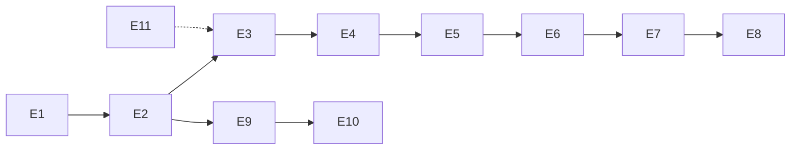

# 00 — Epic- és User Story vázlat

> **Ez a review-pont dokumentum.** Az Epic-ek és a User Story-k címeit,
> pontszámait, prioritásait és függőségeit tartalmazza – a story-k részletes
> törzse (leírás + Acceptance Criteria) a jóváhagyás után kerül a
> **It's a Plan `JGY` projektbe**, ugyanezekkel az azonosítókkal.

---

## 1. Konvenciók

| Fogalom | Jelentés |
| --- | --- |
| **Epic** | Önálló, leszállítható termékterület. 5–14 User Story tartozik hozzá. |
| **User Story** | Egy fejlesztő által egy munkamenetben megvalósítható, **kicsi** szelet. |
| **Pont** | Relatív becslés Fibonacci-skálán: 2 (nagyon kicsi), 3 (kicsi), 5 (közepes), 8 (nagy). |
| **Prioritás** | `urgent` – a működő termékhez elengedhetetlen, `high` – fontos, `medium` – szükséges a teljességhez, `low` – kényelmi. |
| **Függőség** | „ezt előbb kell megvalósítani” (`blocked_by`), illetve a story-k közötti kapcsolat (`relates`). |

A story-k a specifikáció követelményeire hivatkoznak: `FR-xxx`, `BR-xx`,
`NFR-xx`. A story „kész” definíciója az Acceptance Criteria és a hivatkozott
követelmények betartása.

**Összesen: 11 Epic · 88 User Story · 352 pont.**

| Epic | Cím | Story | Pont | It's a Plan |
| --- | --- | --: | --: | --- |
| E1 | Platform alapok és futtatható váz | 7 | 25 | `JGY-3` |
| E2 | Felhasználói fiók és hitelesítés | 8 | 28 | `JGY-11` |
| E3 | Eseménykatalógus és keresés | 10 | 33 | `JGY-20` |
| E4 | Helyszín és ülőhelytérkép | 7 | 34 | `JGY-31` |
| E5 | Jegytípusok és árazás | 5 | 16 | `JGY-39` |
| E6 | Foglalás | 9 | 48 | `JGY-45` |
| E7 | Fizetés | 8 | 39 | `JGY-55` |
| E8 | Jegykibocsátás és értesítések | 9 | 33 | `JGY-64` |
| E9 | Admin backoffice | 14 | 53 | `JGY-74` |
| E10 | Esemény lemondása és visszatérítés | 7 | 32 | `JGY-89` |
| E11 | Nyelv és megjelenítés | 4 | 11 | `JGY-97` |

## 2. Ajánlott megvalósítási sorrend

- **E1** mindennek az előfeltétele.
- **E2** (fiók) az **E3** és **E9** előfeltétele.
- A vásárlási lánc: **E4 → E5 → E6 → E7 → E8**.
- **E9** (backoffice) az **E10** előfeltétele; az **E4** helyszínkezelése az **E3** katalógusára épül.
- **E11** folyamatosan, a felületekkel együtt halad.

---

## 3. Epic-ek és User Story-k

### E1 — Platform alapok és futtatható váz

**Cél:** a rendszer a `docker compose` fájlból egy paranccsal elinduljon, legyen
működő health, egységes hibaválasz, determinisztikus seed és i18n keret.

| ID | User Story | Pont | Prioritás | Követelmény | Függőség |
| --- | --- | --: | --- | --- | --- |
| E1-S1 (JGY-4) | Docker Compose alapú projektváz létrehozása (API, felület, adatbázis) | 5 | urgent | NFR-05, NFR-17 | – |
| E1-S2 (JGY-5) | API health végpont és strukturált naplózás | 2 | high | NFR-08, NFR-17 | E1-S1 |
| E1-S3 (JGY-6) | Egységes hibaválasz-formátum és hibakódok bevezetése | 3 | urgent | NFR-07, VALIDATION_ERROR, UNAUTHENTICATED, FORBIDDEN, NOT_FOUND, RATE_LIMITED, INTERNAL_ERROR | E1-S1 |
| E1-S4 (JGY-7) | Adatbázis migráció és determinisztikus seed keretrendszer | 5 | urgent | NFR-01, NFR-12 | E1-S1 |
| E1-S5 (JGY-8) | Nemzetköziesítési keretrendszer (hu/en) beállítása | 5 | high | NFR-09, BR-14 | E1-S1 |
| E1-S6 (JGY-9) | OpenAPI dokumentáció kiszolgálása | 3 | high | NFR-11 | E1-S1 |
| E1-S7 (JGY-10) | CORS és környezeti konfiguráció kezelése | 2 | urgent | – | E1-S1 |

### E2 — Felhasználói fiók és hitelesítés

**Cél:** regisztráció, bejelentkezés, tokenkezelés, profil és szerepkör-alapú
jogosultság.

| ID | User Story | Pont | Prioritás | Követelmény | Függőség |
| --- | --- | --: | --- | --- | --- |
| E2-S1 (JGY-12) | Regisztráció e-mail címmel és jelszóval | 3 | urgent | FR-101, BR-16, BR-17 | E1-S4 |
| E2-S2 (JGY-13) | Bejelentkezés access és refresh tokennel | 5 | urgent | FR-102 | E2-S1 |
| E2-S3 (JGY-14) | Access token megújítása refresh tokennel | 3 | high | FR-103 | E2-S2 |
| E2-S4 (JGY-15) | Kijelentkezés és refresh token visszavonása | 3 | medium | FR-104 | E2-S2 |
| E2-S5 (JGY-16) | Profil megtekintése és módosítása | 3 | high | FR-105 | E2-S2 |
| E2-S6 (JGY-17) | Jelszócsere a jelenlegi jelszó megadásával | 3 | medium | FR-106 | E2-S2 |
| E2-S7 (JGY-18) | Szerepkör-alapú jogosultság-ellenőrzés az API-n | 5 | urgent | FR-108, BR-20 | E2-S2 |
| E2-S8 (JGY-19) | Inaktív felhasználó kizárása | 3 | high | FR-109, BR-21 | E2-S2 |

### E3 — Eseménykatalógus és keresés

**Cél:** a látogató megtalálja a számára érdekes eseményt.

| ID | User Story | Pont | Prioritás | Követelmény | Függőség |
| --- | --- | --: | --- | --- | --- |
| E3-S1 (JGY-21) | Nyilvános eseménylista | 5 | urgent | FR-201 | E1-S4 |
| E3-S2 (JGY-22) | Szöveges keresés ékezetfüggetlen egyezéssel | 5 | high | FR-202 | E3-S1 |
| E3-S3 (JGY-23) | Szűrés kategóriára, városra és helyszínre | 3 | high | FR-203 | E3-S1 |
| E3-S4 (JGY-24) | Szűrés dátumtartományra | 2 | high | FR-204 | E3-S1 |
| E3-S5 (JGY-25) | Szűrés ártartományra | 3 | medium | FR-205, FR-405 | E5-S5 |
| E3-S6 (JGY-26) | „Van szabad hely” szűrő | 3 | medium | FR-206, BR-03 | E4-S2 |
| E3-S7 (JGY-27) | Rendezés ár, dátum és népszerűség szerint | 2 | medium | FR-207 | E3-S1 |
| E3-S8 (JGY-28) | Lapozás | 2 | high | FR-208 | E3-S1 |
| E3-S9 (JGY-29) | Esemény részletei oldal | 5 | urgent | FR-209 | E3-S1 |
| E3-S10 (JGY-30) | Lemondott és lejárt esemény kezelése | 3 | high | FR-210, FR-908, BR-06, BR-27 | E9-S3 |

### E4 — Helyszín és ülőhelytérkép

**Cél:** a helyszínek és a székek nyilvántartása, valamint a vizuális helyválasztás.

| ID | User Story | Pont | Prioritás | Követelmény | Függőség |
| --- | --- | --: | --- | --- | --- |
| E4-S1 (JGY-32) | Helyszín nyilvántartása (létrehozás, szerkesztés, aktiválás) | 5 | high | FR-301, BR-22 | E2-S7 |
| E4-S2 (JGY-33) | Szektorok, sorok és székek definiálása | 8 | urgent | FR-302 | E4-S1 |
| E4-S3 (JGY-34) | Állóhely-kapacitás megadása | 2 | high | FR-303 | E4-S1 |
| E4-S4 (JGY-35) | Ülőhelytérkép megjelenítése | 8 | urgent | FR-304 | E4-S2, E3-S9 |
| E4-S5 (JGY-36) | Szabad, zárolt és eladott székek jelölése | 3 | urgent | FR-305, BR-01 | E4-S4 |
| E4-S6 (JGY-37) | Székek kijelölése és kijelölés törlése | 5 | urgent | FR-306, BR-29 | E4-S4 |
| E4-S7 (JGY-38) | Térkép állapotának frissítése | 3 | medium | FR-307 | E4-S5 |

### E5 — Jegytípusok és árazás

**Cél:** eseményenként, szektoronként árazott jegytípusok kezelése.

| ID | User Story | Pont | Prioritás | Követelmény | Függőség |
| --- | --- | --: | --- | --- | --- |
| E5-S1 (JGY-40) | Jegytípus létrehozása eseményhez és szektorhoz | 5 | urgent | FR-401, BR-24, BR-28 | E4-S2, E9-S1 |
| E5-S2 (JGY-41) | Ár és vásárlói limit megadása | 3 | high | FR-402, BR-04, BR-15 | E5-S1 |
| E5-S3 (JGY-42) | Értékesítési ablak kezelése | 3 | high | FR-403, BR-05, BR-23 | E5-S1 |
| E5-S4 (JGY-43) | Jegytípus aktiválása és deaktiválása | 3 | medium | FR-404, BR-25 | E5-S1 |
| E5-S5 (JGY-44) | Legkisebb jegyár megjelenítése | 2 | medium | FR-405 | E5-S2 |

### E6 — Foglalás

**Cél:** a helyek zárolása, az összegzés kiszámítása és az egyidejűség kezelése.

| ID | User Story | Pont | Prioritás | Követelmény | Függőség |
| --- | --- | --: | --- | --- | --- |
| E6-S1 (JGY-46) | Foglalás létrehozása ülőhelyekre | 8 | urgent | FR-501, BR-01, BR-02 | E4-S6, E5-S1 |
| E6-S2 (JGY-47) | Foglalás létrehozása állóhelyre darabszámmal | 5 | urgent | FR-502, BR-03 | E5-S1 |
| E6-S3 (JGY-48) | Helyek zárolása és a zár lejárata | 8 | urgent | FR-503, FR-504, BR-02 | E6-S1 |
| E6-S4 (JGY-49) | Foglalás összegzésének kiszámítása | 3 | high | FR-505, BR-07 | E6-S1 |
| E6-S5 (JGY-50) | Vásárlói limit érvényesítése | 5 | high | FR-506, BR-04 | E6-S1 |
| E6-S6 (JGY-51) | Kapacitás érvényesítése | 5 | urgent | FR-507, BR-03 | E6-S2 |
| E6-S7 (JGY-52) | Foglalás lemondása fizetés előtt | 3 | high | FR-508 | E6-S1 |
| E6-S8 (JGY-53) | Foglalás állapotának és záróidejének megjelenítése | 3 | high | FR-509 | E6-S3 |
| E6-S9 (JGY-54) | Egyidejű foglalások kezelése | 8 | urgent | FR-510, NFR-02 | E6-S1, E6-S6 |

### E7 — Fizetés

**Cél:** a vásárlási folyamat lezárása szimulált bankkártyás fizetéssel.

| ID | User Story | Pont | Prioritás | Követelmény | Függőség |
| --- | --- | --: | --- | --- | --- |
| E7-S1 (JGY-56) | Fizetési űrlap és fizetés indítása | 5 | urgent | FR-601 | E6-S4 |
| E7-S2 (JGY-57) | Kártyaadatok validálása | 5 | high | FR-602, BR-12 | E7-S1 |
| E7-S3 (JGY-58) | Mock fizetési szolgáltatás determinisztikus kimenetelekkel | 5 | urgent | FR-603, BR-13 | E7-S1 |
| E7-S4 (JGY-59) | Sikeres fizetés feldolgozása | 8 | urgent | FR-604, BR-09 | E7-S3 |
| E7-S5 (JGY-60) | Sikertelen fizetés kezelése és újrapróbálás | 5 | urgent | FR-605 | E7-S3 |
| E7-S6 (JGY-61) | Fizetési kérés idempotenciája | 5 | medium | FR-606, BR-08 | E7-S3 |
| E7-S7 (JGY-62) | Fizetési tranzakciók naplózása | 3 | high | FR-607 | E7-S3 |
| E7-S8 (JGY-63) | Fizetési hibák megjelenítése a felületen | 3 | high | FR-608, BR-14 | E7-S5 |

### E8 — Jegykibocsátás és értesítések

**Cél:** a megvásárolt jegyek előállítása, letöltése és kiküldése.

| ID | User Story | Pont | Prioritás | Követelmény | Függőség |
| --- | --- | --: | --- | --- | --- |
| E8-S1 (JGY-65) | Jegyek kiállítása sikeres fizetés után | 5 | urgent | FR-701, BR-09 | E7-S4 |
| E8-S2 (JGY-66) | Egyedi, meg nem jósolható jegykód generálása | 2 | urgent | FR-702, BR-30 | E8-S1 |
| E8-S3 (JGY-67) | PDF jegy előállítása | 5 | high | FR-703 | E8-S1 |
| E8-S4 (JGY-68) | QR-kód megjelenítése a jegyen | 3 | high | FR-704 | E8-S2 |
| E8-S5 (JGY-69) | Jegy letöltése jogosultság-ellenőrzéssel | 3 | high | FR-705, BR-20 | E8-S3 |
| E8-S6 (JGY-70) | Jegy érvényességének nyilvános ellenőrzése | 3 | medium | FR-706 | E8-S2 |
| E8-S7 (JGY-71) | Értesítő e-mail küldése vásárlás után | 5 | urgent | FR-707 | E8-S3 |
| E8-S8 (JGY-72) | Jegy e-mail újraküldése | 2 | low | FR-708 | E8-S7 |
| E8-S9 (JGY-73) | „Jegyeim” oldal | 5 | urgent | FR-709, FR-107 | E8-S1, E2-S5 |

### E9 — Admin backoffice

**Cél:** a szervezők és adminisztrátorok munkafelülete.

| ID | User Story | Pont | Prioritás | Követelmény | Függőség |
| --- | --- | --: | --- | --- | --- |
| E9-S1 (JGY-75) | Esemény létrehozása | 5 | urgent | FR-801 | E4-S1 |
| E9-S2 (JGY-76) | Esemény szerkesztése állapotfüggő korlátokkal | 5 | urgent | FR-802, BR-11 | E9-S1 |
| E9-S3 (JGY-77) | Esemény publikálása | 5 | urgent | FR-803, BR-19 | E9-S2, E5-S3 |
| E9-S4 (JGY-78) | Értékesítés szüneteltetése és folytatása | 3 | medium | FR-804 | E9-S3 |
| E9-S5 (JGY-79) | Esemény törlése | 2 | medium | FR-805 | E9-S1 |
| E9-S6 (JGY-80) | Eseménylista szűréssel | 3 | high | FR-806, BR-20 | E9-S1 |
| E9-S7 (JGY-81) | Felhasználók listázása és keresése | 3 | medium | FR-807 | E2-S7 |
| E9-S8 (JGY-82) | Felhasználó szerepkörének módosítása | 3 | medium | FR-808 | E9-S7 |
| E9-S9 (JGY-83) | Felhasználó aktiválása és deaktiválása | 3 | medium | FR-809, BR-21 | E9-S7, E2-S8 |
| E9-S10 (JGY-84) | Foglalások listázása és szűrése | 5 | high | FR-810 | E6-S1 |
| E9-S11 (JGY-85) | Foglalás részleteinek megtekintése | 3 | high | FR-811 | E9-S10 |
| E9-S12 (JGY-86) | Esemény statisztika | 5 | medium | FR-812 | E9-S10 |
| E9-S13 (JGY-87) | Szervezői jogosultsági korlát érvényesítése | 5 | urgent | FR-813 | E9-S2 |
| E9-S14 (JGY-88) | Visszatérítések listája | 3 | medium | FR-814 | E10-S2 |

### E10 — Esemény lemondása és visszatérítés

**Cél:** esemény lemondása és a vásárlók automatikus kártalanítása.

| ID | User Story | Pont | Prioritás | Követelmény | Függőség |
| --- | --- | --: | --- | --- | --- |
| E10-S1 (JGY-90) | Esemény lemondása adminisztrátor által | 5 | urgent | FR-901 | E9-S3 |
| E10-S2 (JGY-91) | Fizetett foglalások automatikus visszatérítése | 8 | urgent | FR-902, BR-10 | E10-S1, E7-S4 |
| E10-S3 (JGY-92) | Függő foglalások lezárása és helyek felszabadítása | 5 | urgent | FR-903 | E10-S1, E6-S3 |
| E10-S4 (JGY-93) | Jegyek visszavonása és QR érvénytelenítése | 3 | urgent | FR-904, BR-18 | E10-S1, E8-S4 |
| E10-S5 (JGY-94) | Értesítés a lemondásról és a visszatérítésről | 3 | high | FR-905 | E10-S2, E8-S7 |
| E10-S6 (JGY-95) | Pénzügyi napló vezetése | 5 | high | FR-906 | E10-S2 |
| E10-S7 (JGY-96) | Ismételt lemondás és visszatérítés tiltása | 3 | medium | FR-907, REFUND_ALREADY_ISSUED | E10-S2 |

### E11 — Nyelv és megjelenítés

**Cél:** a felület és az értesítések magyarul és angolul is teljesek legyenek.

| ID | User Story | Pont | Prioritás | Követelmény | Függőség |
| --- | --- | --: | --- | --- | --- |
| E11-S1 (JGY-98) | Nyelvváltó a felületen | 3 | high | FR-1001, BR-14 | E1-S5 |
| E11-S2 (JGY-99) | API hibaüzenetek nyelvfüggése | 3 | high | FR-1002 | E1-S3 |
| E11-S3 (JGY-100) | Dátum és pénzösszeg formázása nyelvenként | 3 | high | FR-1003, BR-15 | E1-S5 |
| E11-S4 (JGY-101) | E-mail sablonok nyelvfüggése | 2 | medium | FR-1004 | E8-S7, E1-S5 |

---

## 4. Ami szándékosan nincs a backlogban

Kuponok és kedvezménykódok, értékelések, wallet és loyalty, vásárló által
kezdeményezett visszatérítés, jegyviszonteladás, valós fizetési integráció,
számlázás, többpénznemes árazás, beléptető alkalmazás.
